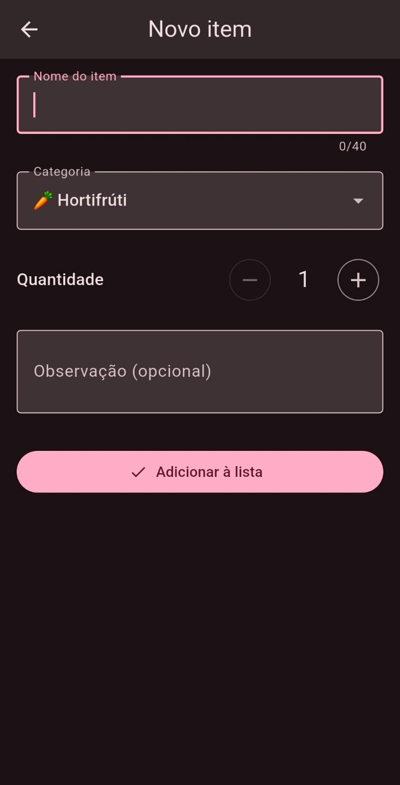
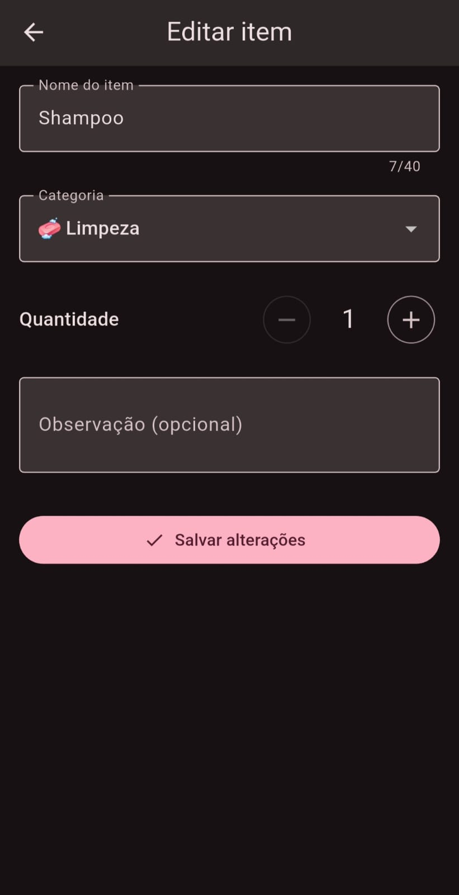
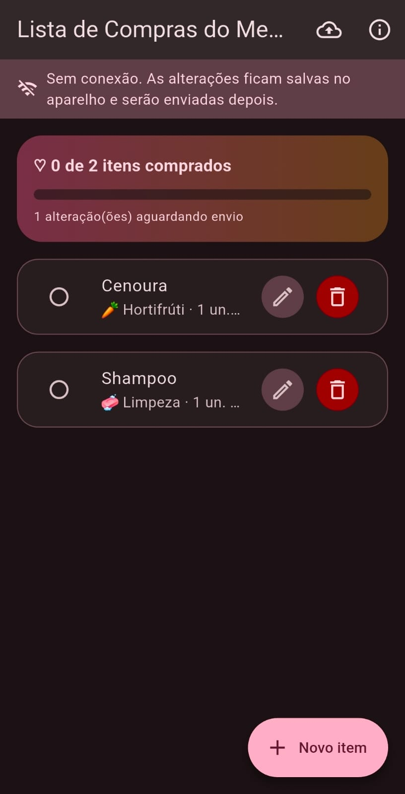
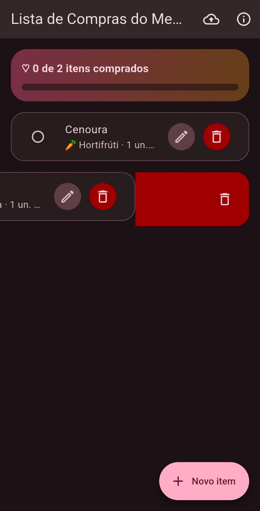

# 🛒 Lista de Compras do Mercado

Aplicativo Android em **Flutter** para organizar as compras do mercado: anotar o que falta, marcar o que já foi para o carrinho e manter tudo salvo no celular, mesmo sem internet.

Projeto desenvolvido a partir do **tutorial integrador da Aula 15** da disciplina *Desenvolvimento para Dispositivos Móveis — 2026* (IFB), que reúne os conceitos das Aulas 11 a 14: árvore de widgets e responsividade, arquitetura em camadas, gerenciamento de estado, SQLite, conectividade intermitente, navegação declarativa, ligação profunda e canal de plataforma.

Material da disciplina (Prof. claulis): [Desenvolvimento-para-Dispositivos-Moveis-2026](https://github.com/claulis/Desenvolvimento-para-Dispositivos-Moveis-2026) · [tutorial da Aula 15](https://github.com/claulis/Desenvolvimento-para-Dispositivos-Moveis-2026/blob/main/aulas/aula-15-flutter-tutorial-integrador-sqlite.md)

## 📥 Download do APK

O APK fica na aba **[Releases](../../releases)** deste repositório. Ele é gerado automaticamente pelo GitHub Actions a cada atualização do código (veja [`.github/workflows/gerar-apk.yml`](.github/workflows/gerar-apk.yml)).

Para instalar: baixar o arquivo `.apk` no celular Android, abrir e permitir **"Instalar apps desconhecidos"** quando o Android pedir.

## 👥 Autoria

- Alice Gomes Azevedo
- Sarah
- Wagner

Turma: Desenvolvimento para Dispositivos Móveis — 2026 · Instituto Federal de Brasília

## 📱 O app funcionando

| Lista de compras | Novo item | Editar item |
|---|---|---|
|  |  |  |

| Sem internet | Tela "Sobre" | Descartar alterações |
|---|---|---|
|  |  |  |

## ✨ Funcionalidades

- Cadastrar itens com nome, categoria (Hortifrúti, Açougue, Padaria, Mercearia, Bebidas, Limpeza, Higiene), quantidade e observação, com validação dos campos.
- Marcar itens como comprados (eles descem para o fim da lista) e excluir arrastando para a esquerda.
- Editar um item em tela própria, com confirmação antes de descartar alterações não salvas.
- Dados guardados em um banco **SQLite** no próprio celular.
- Envio das alterações a um servidor (simulado), com nova tentativa automática e indicação de itens pendentes.
- Aviso quando não há internet e sincronização automática quando a conexão volta.
- Abrir um item direto por um endereço `compras://app/item/<id>` (ligação profunda).
- Tela "Sobre" com autoria, dados do aparelho obtidos por código **Kotlin** e data de criação do banco.
- Grade com 1, 2 ou 3 colunas conforme a largura da tela, tema claro e escuro, suporte a fonte ampliada e leitor de tela.

## 🏗️ Arquitetura

O app usa **arquitetura em camadas** (Aula 12). Cada camada tem uma responsabilidade, e as dependências apontam sempre para o **domínio**, que é o centro do sistema.

```text
┌──────────────────────── Apresentação ────────────────────────┐
│ telas e componentes (widgets)                                │
│ providers.dart: estado observado pela interface e montagem   │
│                 das dependências                             │
└───────────────┬──────────────────────────────────────────────┘
                │ usa
┌───────────────▼──────────────────────────────────────────────┐
│ Domínio: Item, regras de validação e ordenação,              │
│          contrato ItemRepository                             │
└───────────────▲──────────────────────────────────────────────┘
                │ implementa
┌───────────────┴──────────────────────────────────────────────┐
│ Dados: SQLite, servidor simulado, sincronização,             │
│        canal de plataforma                                   │
└──────────────────────────────────────────────────────────────┘
```

### Camada de domínio (`lib/dominio/`)

É o que o aplicativo **é**, sem depender de Flutter, SQLite ou rede.

- `item.dart`: a entidade `Item`, **imutável** (todos os campos são `final`). Para alterar um item, cria-se uma cópia com `copyWith`.
- `regras_item.dart`: regras de negócio puras: validar o nome (2 a 40 caracteres), limitar a quantidade (1 a 99), ordenar a lista (itens a comprar primeiro, depois por categoria e nome) e calcular o resumo (comprados e pendentes de envio).
- `item_repository.dart`: o **contrato** `ItemRepository`, que diz *o que* o app precisa para guardar itens, sem dizer *como*.

Como o domínio só declara o contrato e a camada de dados o implementa, a dependência fica **invertida**: os dados dependem do domínio, e não o contrário. Isso permite testar as regras sem banco de dados.

### Camada de dados (`lib/dados/`)

É *como* as coisas são guardadas e enviadas.

- `local/banco_de_dados.dart`: abre o arquivo SQLite `compras.db` e cria as tabelas `itens` e `metadados`. A tabela tem restrições como `NOT NULL` e `CHECK (quantidade BETWEEN 1 AND 99)`, uma defesa em profundidade além da regra de domínio.
- `local/item_mapper.dart`: converte um `Item` em linha da tabela e vice-versa (o SQLite não tem tipos booleano nem data: usa 0/1 e milissegundos).
- `local/item_repository_sqlite.dart`: implementa o `ItemRepository` com SQL parametrizado (`?`), o que impede injeção de SQL. Usa **concorrência otimista** ao marcar um item como enviado: só marca se ele não tiver sido alterado durante o envio.
- `remoto/nova_tentativa.dart`: repete falhas temporárias com **espera exponencial e jitter** (0,5 s, 1 s, 2 s... mais um tempo aleatório).
- `remoto/servico_remoto_simulado.dart`: imita um servidor real, com atraso de 200 a 800 ms e 30% de falhas.
- `sincronizador.dart`: envia ao servidor os itens pendentes, um por um; a falha de um não impede os outros.
- `plataforma/dispositivo_nativo.dart` + `MainActivity.kt`: **canal de plataforma** (`MethodChannel`) que busca no código Kotlin o fabricante, o modelo, a versão do Android e o nível da bateria.

### Camada de apresentação (`lib/apresentacao/`)

É o que o usuário vê e toca.

- `providers.dart`: usa o **Riverpod** para guardar o estado (`AsyncNotifier` da lista, `Notifier` da sincronização, `StreamProvider` da conectividade). É também o **ponto de montagem** (*composition root*): o único arquivo que sabe que o `ItemRepository` usado é o de SQLite. Nos testes, ele é trocado por um repositório em memória sem mudar nenhuma tela.
- `rotas.dart`: rotas declarativas com **go_router** (`/`, `/item/novo`, `/item/:id`, `/sobre`). As rotas filhas mantêm a lista embaixo na pilha, então "voltar" leva à lista mesmo quando o item é aberto por link.
- `telas/` e `componentes/`: as telas usam `AsyncValue.when` para os estados de carregando, erro e dados, `LayoutBuilder` para a grade responsiva, `PopScope` para confirmar o descarte e `Semantics` para acessibilidade.

### Exemplo do fluxo: marcar um item como comprado

1. O `Checkbox` do `CartaoItem` chama `ItensNotifier.alternarComprado(item)`.
2. O notifier cria uma cópia do item com `comprado` invertido e chama `ItemRepository.salvar`.
3. O repositório SQLite faz um `UPDATE` e marca o item como pendente de envio.
4. O notifier relê a tabela, ordena com a regra de domínio e publica o novo estado.
5. A tela é reconstruída: o item aparece riscado, desce para o fim e mostra o ícone de "aguardando envio".

### Estrutura de pastas

```text
lib/
├── main.dart, app.dart          ← ponto de entrada, temas e roteador
├── config/identidade.dart       ← nome, autoria, cor e categorias
├── dominio/                     ← entidade, regras e contrato
├── dados/                       ← SQLite, servidor simulado, sincronização, canal nativo
└── apresentacao/                ← providers, rotas, telas e componentes
test/                            ← testes de domínio, de dados e de interface
android/app/src/main/            ← AndroidManifest.xml e MainActivity.kt
```

## 🛠️ Tecnologias

| Pacote | Uso |
|---|---|
| `flutter_riverpod` | Gerenciamento de estado e injeção de dependências |
| `go_router` | Rotas declarativas e ligação profunda |
| `sqflite` + `path` | Banco SQLite no Android |
| `connectivity_plus` | Detectar se há internet |
| `sqflite_common_ffi` | SQLite no computador, para os testes |

## ✅ Testes

São 16 testes automatizados, que rodam no GitHub Actions a cada atualização:

| Nível | Arquivo | O que verifica |
|---|---|---|
| Domínio | `test/dominio/regras_item_test.dart` | Validação, limites de quantidade, ordenação e resumo |
| Dados | `test/dados/nova_tentativa_test.dart` | Nova tentativa e desistência |
| Dados (SQLite real) | `test/dados/item_repository_sqlite_test.dart` | Inserção, atualização, exclusão e concorrência otimista |
| Interface | `test/apresentacao/fluxo_da_lista_test.dart` | Listar, validar e adicionar um item de ponta a ponta |

Para rodar no computador (com Flutter instalado):

```bash
flutter pub get
flutter analyze
flutter test
```

## ▶️ Como executar localmente

Com o Flutter e o Android SDK instalados e um emulador ou celular conectado:

```bash
flutter create --org br.com.listamercado --project-name compras --platforms android .
flutter pub get
flutter run
```

O primeiro comando só completa os arquivos padrão do Android (ícones, Gradle); ele não sobrescreve o código do projeto. Apague o `test/widget_test.dart` que ele criar.

Para testar a ligação profunda com o app instalado:

```bash
adb shell am start -W -a android.intent.action.VIEW -d "compras://app/item/1" br.com.listamercado.compras
```
